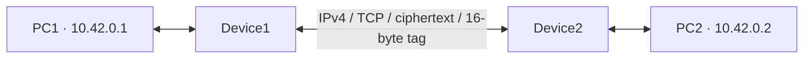

# Aegis Inline

A Linux C prototype that protects selected IPv4/TCP traffic between two inline devices. The application on each endpoint uses a normal TCP socket. Each device forwards Ethernet frames through Linux packet sockets.



| Requirement | Implementation |
| --- | --- |
| Diffie–Hellman before forwarding | TLS 1.3 requires ephemeral X25519 ECDH and authenticates both devices with role-specific certificates. Each device exports the same two directional AES-256 keys. |
| Encrypt only the TCP payload | AES-256-GCM encrypts the existing payload. The same Ethernet, IPv4, and TCP headers travel on the direct link. IPv4 total length and IPv4/TCP checksums reflect the added 16 bytes. |
| Append the GCM tag | The tag immediately follows the ciphertext. The protected frame retains IPv4 protocol number 6 and the original TCP ports. |
| Recover original packet | The receiving device verifies the tag, strips it, restores the plaintext, and recalculates IPv4 and TCP checksums. |
| Unique nonce per packet | Each direction uses a distinct four-byte identifier and a strictly increasing eight-byte counter. TCP retransmissions receive fresh counters. |

The TLS connection on TCP port 7443 carries session setup and readiness. Application packets take the raw Ethernet path. See [Design and security](docs/design.md) for the byte layout, counter recovery, and limits.

## Build and test

Use a Linux host or VM. The source builds with a C11 compiler and OpenSSL 3.x.

```bash
sudo apt update
sudo apt install build-essential libssl-dev openssl iproute2 ethtool tcpdump python3
make test
sudo make integration
```

`make test` needs a local TCP loopback and ordinary user privileges. It checks packet transforms, checksums, nonce use on retransmissions, tampering, replay, bounded reordering, MTU limits, and TLS authentication. The namespace integration test requires Linux packet socket and namespace privileges. It creates four isolated namespaces and three virtual Ethernet links, checks the blocked path before setup, transfers data in both directions, verifies the port policy, and compares LAN and transit packet captures. It cleans up afterward.

Expected output ends with lines beginning with `PASS`. The test workflow runs both targets when pushed to GitHub.

## Run with four hosts

Use dedicated Ethernet links. Set PC1 to `10.42.0.1/24` and PC2 to `10.42.0.2/24`. The commands below assume the device interfaces are named `lan0` and `wan0`, and the endpoint interfaces are named `eth0`. Adjust names to match your equipment.

| Link | Interfaces | MTU |
| --- | --- | --- |
| PC1 to Device1 | PC1 `eth0`, Device1 `lan0` | 1484 |
| Device1 to Device2 | Both `wan0` | 1500 |
| Device2 to PC2 | Device2 `lan0`, PC2 `eth0` | 1484 |

Give the device transit interfaces addresses `172.30.0.1/30` and `172.30.0.2/30` respectively. Leave their LAN interfaces unnumbered. Use separate interfaces without a kernel bridge between them. Bring each interface up and disable transmit checksum and segmentation/receive coalescing offloads where enabled. For example, on Device1:

```bash
sudo ip link set dev lan0 mtu 1484 up
sudo ip link set dev wan0 mtu 1500 up
sudo ip addr add 172.30.0.1/30 dev wan0
sudo ethtool -K lan0 tx off tso off gso off gro off
sudo ethtool -K wan0 tx off tso off gso off gro off
```

Generate the role credentials once on a trusted machine using `./scripts/make-certs.sh`. Install `certs/ca.pem` and the corresponding role's private PEM on each device via a trusted channel. Protect the private PEM files and keep them out of Git. Run `make` on both devices.

Start Device2 first, then start Device1 within ten seconds.

```bash
# Device2
sudo ./build/aegis-inline 2 lan0 wan0 172.30.0.2 172.30.0.1 \
  7443 10.42.0.1 10.42.0.2 8080 certs/ca.pem certs/device2.pem

# Device1
sudo ./build/aegis-inline 1 lan0 wan0 172.30.0.1 172.30.0.2 \
  7443 10.42.0.1 10.42.0.2 8080 certs/ca.pem certs/device1.pem
```

Once both devices report `ready`, start a simple server on PC2 and connect from PC1.

```bash
# PC2
python3 -m http.server 8080 --bind 10.42.0.2

# PC1
curl http://10.42.0.2:8080/
```

On either device, capture the protected frames with:

```bash
sudo tcpdump -ni wan0 -s 0 -XX 'tcp and host 10.42.0.1 and host 10.42.0.2 and port 8080'
```

## Publish on GitHub

From the extracted `aegis-inline` folder, authenticate with the GitHub CLI and publish the project.

```bash
git init -b main
git add .
git commit -m "Implement Aegis Inline secure TCP channel"
gh auth login
gh repo create aegis-inline --source=. --private --remote=origin --push
gh repo view --json url --jq .url
```

If your instructor requires a public repository, choose `--public` in place of `--private`. For a private repository, grant your instructor access before sending the printed URL. [GitHub publishing instructions](https://docs.github.com/en/migrations/importing-source-code/using-the-command-line-to-import-source-code/adding-locally-hosted-code-to-github)

## Source layout

| Path | Purpose |
| --- | --- |
| `src/main.c` | Linux Ethernet I/O, role selection, forwarding loop |
| `src/session.c` | Mutual TLS handshake and directional key export |
| `src/packet.c` | Frame selection, AES-GCM, nonce window, checksums |
| `scripts/make-certs.sh` | Local demo certificate generation |
| `tests/` | Packet and handshake tests, namespace integration and capture checks |
